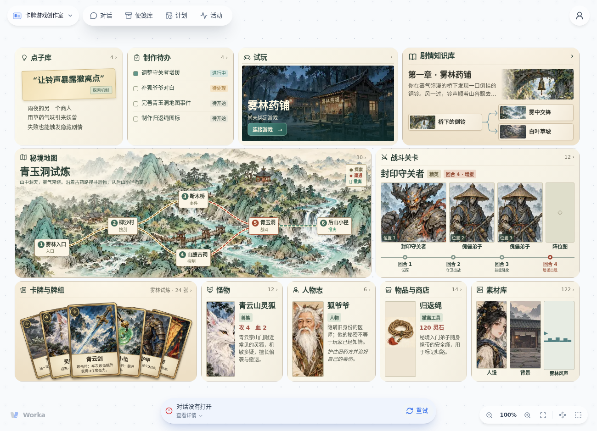

# 卡牌游戏创作室

一套供个人开发剧情向、搜打撤卡牌游戏的 Worka 桌面。游戏代码、Markdown 剧情和素材继续保存在 CardGame 仓库。平时从 Worka 原生输入框提要求，在便笺里看内容、用框选留言反馈，在「试玩」里操作真实游戏。



## 导入

在含[共享连接初始化](https://github.com/kllilizxc/dsh-worka-bench/pull/88)的 Worka 中，打开「导入桌面」。审查期间粘贴功能分支地址 `https://github.com/kllilizxc/worka-cardgame-studio/tree/feat/qingyun-native-studio`；合入后直接使用仓库地址 `https://github.com/kllilizxc/worka-cardgame-studio`。Worka 会安装十一张便笺、三条连线以及随桌面发布的 `game-project` 后台。接收者无需编译。1.x 用户可以把此版本导入为独立桌面。

导入后可以直接浏览「雾林试炼」。点子和待办属于当前桌面的可编辑记录。山水路线上的地点、章节分支、叠放的牌面和增援事件分别打开对应记录。点便笺标题可进入总览。剧情知识库可切换章节与脑图，素材等内容库支持搜索、筛选和分页。

## 连接游戏

在共享初始化对话中提供已检出的本地游戏目录，或可访问的 GitHub HTTPS 地址。开发中的本地修改会进入工作稿索引。提供 URL 时，Worka 在宿主机上为这个桌面建立游戏工作区。九张使用游戏内容的便笺共用本桌面的连接。另一个桌面可连接另一份游戏。

桌面用随包示例展示六处青玉洞路线、二十四张试炼牌组和第四回合增援。这些设计示例保存在 `examples/qingyun`。连接成功后，故事、素材、敌阵和事件以选定游戏的真实文件为准。已打开的便笺会重新读取内容。试玩使用 Git 提交和游戏适配器，可从制作事项进入候选版本、从剧情或战斗记录启动定点试玩。

在 Worka 原生对话里说「连接这份 CardGame 仓库」或「刷新游戏索引」即可。作者也可以在桌面源码目录调用同一个 provider。

```sh
node tools/setup.mjs --game /你的路径/CardGame --desktop <桌面ID>
node tools/setup.mjs --desktop <桌面ID>
```

刷新读取当前检出和未提交的编辑。GitHub 上游更新需先同步到本机检出。点子、待办、试玩反馈保存在桌面里。

## 便笺和连线

| 便笺 | 打开后 |
| --- | --- |
| 点子库 | 记录原话、标签和分类。以后交办相关功能时，Worka 可在制作对话里主动推荐旧点子。 |
| 制作待办 | Worka 原生 Todo。交办后沿用事项的原生对话，可追溯修改与反馈。 |
| 剧情知识库 | 章节侧栏、对白搜索、Markdown 正文与可展开、下探的脑图，两个视图共用场景 ID。 |
| 秘境地图 | 地图和房间、路线、出口与事件，战斗房可直接试玩对应遭遇。普通房间从游戏定义的秘境入口试玩。 |
| 战斗关卡 | 查看敌方阵位、实际数值、卡组和游戏数据已定义的特殊事件，再进入该战斗。 |
| 卡牌与牌组、怪物、人物志、物品与商店 | 独立便笺，共用索引和分页查询。卡牌展示牌效，敌人展示属性与出场，NPC 展示人物配置，商店展示货架与价格。 |
| 素材库 | 背景、人设、卡面、其他图像、声音与音乐按实际文件和用途分类。 |
| 试玩 | 打开当前版本。有多个正式候选时可切换版本。场景和关卡的定点试玩独立于普通版本列表。 |

点子推荐会在真实 Worka 模型会话中生成。

两条有业务动作的连线分别负责「制作时推荐点子」和「交付试玩」。第三条「内容引用」只提供 Worka 原生 links，没有订阅事件。点击游戏引用可以定位到具体记录，无需进入中间总览；需要静态引用的连线要随桌面一起导入。

## 开发与发布

- `notes/` 是五套便笺的可维护源码。七张内容便笺共用 `notes/catalog`，发布时各自获得一个可独立激活的目录。
- `published/` 是 Worka 发布编译器生成并校验的产物。不要手改清单或哈希。随包游戏索引取自 CardGame，展示示例单独存放在 examples/qingyun。
- `provider/` 维护本机项目绑定和共享索引。在包作者环境运行 `bun tools/build-provider.mjs /你的路径/dsh-worka-bench` 更新原生后台制品。
- `connections/` 包含原生连线定义，`playtest/` 包含候选预览适配器，`tools/` 包含索引和绑定工具。运行 `node --test` 检查本仓库，设置 `CARDGAME_ROOT` 可对真实游戏数据执行回归。
- 刷新可发布的游戏内容时运行 `node tools/setup.mjs --game /你的路径/CardGame --release`。这一步生成**可移植**的配置和静态 links。日常绑定不加 `--release`。发布时整份初始清单须小于 1.9 MiB。较大的项目先导入随包内容，再绑定自己的仓库。绑定时剧情正文按需读取原文件，每张便笺的索引预算为 5.9 MiB；超过时会在写入前报告是哪一张。
- 修改便笺后，使用已安装开发依赖的 Worka 源码及其 Bun 版本执行 `bun tools/build-notes.mjs /你的路径/dsh-worka-bench`。如素材本身变化，先用 `node tools/catalog-media.mjs /你的路径/CardGame /你的路径/dsh-worka-bench` 更新离线预览，再重建发布包。接收者使用已提交的产物。
- 游戏来源为 [CardGame](https://github.com/kllilizxc/CardGame)。Todo、知识库、候选预览及 SDK 编译契约来自 [Worka](https://github.com/kllilizxc/dsh-worka-bench)。源码许可见 LICENSE。原游戏素材依照其上游许可使用。
