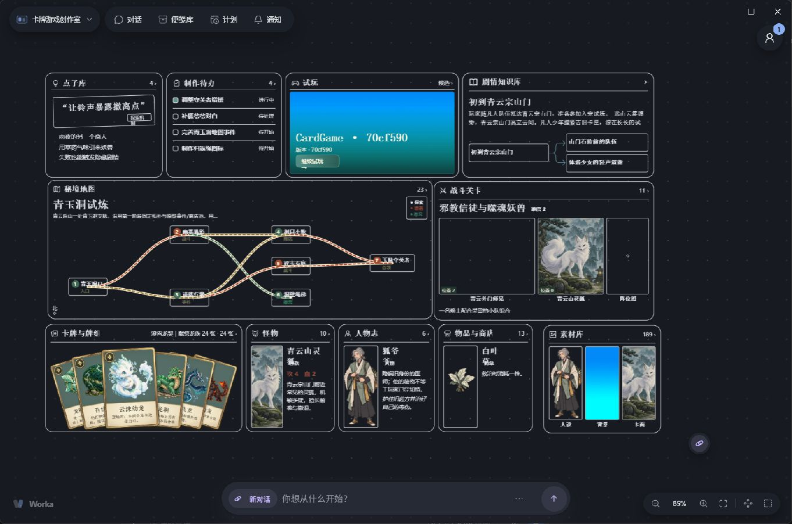

# 卡牌游戏创作室

供个人开发剧情向、搜打撤卡牌游戏的 Worka 桌面：告诉 Agent 一个想法，直接试玩结果并给出反应。



## 导入与绑定游戏

在 Worka 中打开「导入桌面」，粘贴仓库地址 `https://github.com/kllilizxc/worka-cardgame-studio`。Worka 会安装 11 张独立便笺、5 条连线以及随桌面发布的 `game-project` 后台。

首次导入只问一个问题来选择要连接的游戏仓库：默认克隆 [CardGame](https://github.com/kllilizxc/CardGame)，也可以选择本机已检出的目录。桌面本身不嵌入静态索引，也无需手动刷新：绑定后所有内容便笺按页实时读取当前检出中的真实文件，源文件改动后已打开的便笺会自动更新。

## 便笺与连线

### 11 张便笺

- **点子库**：保存想法原话、分类与标签。
- **制作待办**：Worka 原生待办，承载制作事项及其工作会话。
- **试玩**：Worka 原生候选预览，按提交与场景/战斗入口运行隔离试玩。
- **剧情知识库、秘境地图、战斗关卡、卡牌与牌组、怪物、人物志、物品与商店、素材库**：各自按页实时读取所属类别的游戏文件，支持在本便笺对话里直接修改所属部分并运行游戏检查。

### 5 条连线

| 连线 | 职责 |
| --- | --- |
| 点子 → 制作 | 具体点子自动转为制作事项并在游戏仓库分支/工作树开工，开工时带出相关的旧点子；模糊点子仅入库并一句话回复。 |
| 内容便笺 → 制作 | 内容便笺里超出本便笺自身部分的跨模块请求转为关联到所指记录的制作事项。 |
| 制作 → 试玩 | 分支提交后登记直达受影响场景或战斗的可试玩构建，并把试玩链接发到事项对话中。 |
| 试玩 → 制作 | 试玩反馈回到原制作事项会话；回复 `OK` 即合入游戏 `main` 分支（GitHub 远端一并推送）并将事项标为完成。 |
| 内容引用 | 根据每条记录自身的引用实时计算跨便笺跳转关联。 |

## 开发构建

修改 `provider/` 或 `notes/` 后，使用已安装依赖的 Worka 源码执行：

```sh
bun tools/build-provider.mjs /path/to/dsh-worka-bench
bun tools/build-notes.mjs /path/to/dsh-worka-bench
node --test
```

`published/` 为编译器生成的发布制品，不要手改其中的清单或哈希。源码许可参见 LICENSE。
